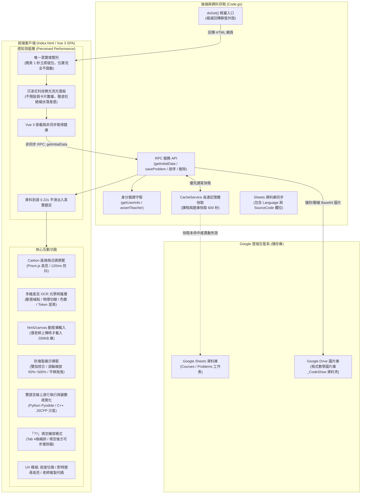

# 程式設計教學展示系統 (CodeShow) 系統架構與部署指南

本專案專為程式教學設計，基於 **Google Apps Script (GAS) + Google Sheets + Google Drive + Vue 3 單頁應用 (SPA)** 架構，兼顧極致的**防抄襲防 OCR 保護**、**秒級感知效能載入體驗**與**零伺服器維護成本**。

---

## 系統整體架構圖

---

## 系統核心特色與技術架構

### 1. 🚀 極速感知載入架構 (Perceived Performance)
為了解決 Google Apps Script (GAS) 伺服器冷啟動 (Cold Start) 帶來的 3~5 秒白畫面等待感，同時完美克服學校電腦教室「硬體還原卡每次開機清空快取」的教學痛點，系統實作了**現代化感知效能與微光佔位架構**：
* **反轉 `doGet()` 負載（1 秒內極速回傳外殼）**：
  * `doGet()` 專注於極速回傳靜態網頁外殼，不進行阻塞型的 Sheets 同步讀取，首包響應時間由原本的 3~5 秒驟降至 ~1 秒。
  * 頂部真實導覽列（💻 程式設計教學展示庫）、搜尋框與密度切換按鈕在開頁第 1 秒就位，使用者立即獲得明確視覺反饋，告別漫長白畫面。
* **沉浸式微光流光同步面板 (Glow Sweep Placeholder)**：
  * **不預設假卡片格數**：傳統骨架屏若預留 6 張，遇到只有 3 題的課程會產生「內容縮水被吃掉」的視覺落差。本系統改採全幅深色流光微光面板（「正在載入課堂題庫... 同步最新教學範例程式碼」），絕不給大腦過度承諾。
  * **還原卡零落差適應**：學校電腦教室每次開機即使清空快取，學生一開頁皆以極具科技感的紫色掃光動態呈現，資料抵達後以 `0.22s` 平滑淡入 (`animate-content-in`) 展開真實題目，不管是 3 題還是 7 題皆呈現「內容浮現」的豐富感，達到 100% 零跳動。
* **CacheService 記憶體快取加速**：
  * 後端透過 `CacheService.getScriptCache()` 將課程與題目目錄快取 10 分鐘 (600 秒)，並設有 100KB 容量保護機制。
  * 當老師執行**新增題目、刪除題目、調整排序、增刪課程**時，自動呼叫 `clearSystemCache()` 精準失效快取，兼顧高速與資料一致性。
* **函式庫按需懶載入 (Lazy Load on Demand)**：
  * 將高達 200KB 的截圖庫 `html2canvas.min.js` 自首頁靜態資源移除。
  * 佔比 95% 以上的純閱讀學生端永遠不需要下載該函式庫；僅在老師開啟「➕ 上傳程式碼」彈窗時，由 `ensureHtml2CanvasLoaded()` 動態注入腳本非同步預熱載入。
* **單次整合 RPC (getInitialData)**：
  * 將傳統「身分驗證 $\to$ 讀取課程 $\to$ 讀取題目」的 3 次遠端往返整合為一次原子呼叫，極致減少連線 Handshake 開銷。

---

### 2. 🛡️ 7 重反 OCR 光學字元辨識系統（瓦解 Google 智慧鏡頭 / iOS 原況文字）
為了確保學生親手敲打鍵盤練習以達到教學成效，程式碼轉成圖片時預設採用**強力防護等級**：
1. **動態微噪點圖層 (Dynamic Noise Layer)**：隨機生成不規則彩色噪點與高頻針刺微短線，破壞固定去噪捲積濾鏡 (Denoising Filters)。
2. **文字微扭曲與基線微傾斜 (Text Warp & Skew)**：加入非線性微小傾斜（`rotate 0.18deg, skewX -0.35deg`），肉眼無感但打亂 OCR 垂直行切分與水平基線演算法。
3. **前置穿透式雙向物理切線 (Cut-lines)**：以 37° 與 127° 雙向微細柵線覆蓋切割字符筆畫，截斷字母連通組件。
4. **雙向色散微重影 (Chromatic Aberration)**：打散字體邊界漸層，使邊緣二值化失準。
5. **偽字符混淆網 (Ghost Tokens)**：在行距與背景散佈隨機微縮字符，稀釋神經網絡注意力權重，使 OCR 提取出亂碼語法。
6. **非線性漸層遮罩 (Vignette Mask)**：打破影像全域與局部 Otsu 二值化閥值。
7. **穿透式重複中文浮水印**：多道斜向浮水印橫跨程式碼，中英文 Token 混淆。
* 支援「強力防護 / 標準防護 / 關閉」一鍵切換與「🎲 隨機變換干擾噪點」按鈕。

---

### 3. 🔒 身分驗證與伺服器端資安架構
* **自動比對 Google 帳號**：
  * 利用 `Session.getActiveUser().getEmail()` 取得訪客帳號，比對試算表擁有者 (Owner) 或 `ADDITIONAL_TEACHER_EMAILS` 授權清單。
  * 老師本人開啟自動進入「👨‍🏫 老師管理模式」，無須手動輸入任何帳號密碼。
* **後端嚴格防護守衛 (`assertTeacher()`)**：
  * 所有寫入操作（`addCourse`、`deleteCourse`、`saveProblem`、`updateProblemsOrder`、`deleteProblem`、`deleteChapter`）在進入後端邏輯的第一行均強制執行 `assertTeacher()`。
  * 即便學生端透過瀏覽器開發者工具 (DevTools) 嘗試直接調用 `google.script.run`，也會直接被 GAS 後端拋出例外攔截，安全性堅固。

---

### 4. 🎨 使用者體驗 (UX) 與展示設計
* **圖片放大檢視與自由平移 (Zoom & Pan)**：
  * 彈窗支援滑鼠滾輪縮放（50% ~ 500%）、觸控雙指捏合手勢縮放、按住滑鼠任意拖曳平移。
  * 附帶「💡 手勢說明」指引卡片，點擊「我知道了」能即刻關閉，操作不衝突。
* **智慧章節排序與時間由舊到新**：
  * 自動解析中文數字（「一、」、「十、」）與阿拉伯數字編號排序章節。
  * 同章節內題目依進度由舊到新排列，並支援老師點擊「◀ / ▶」按鈕一鍵調換順序，即時同步試算表。
* **即時搜尋關鍵字高亮**：輸入關鍵字時，題號與章節名稱自動亮黃色高亮標記匹配字串。
* **卡片顯示密度自由切換**：提供「🔲 緊湊（一列 ≥5~6 題）」與「🔳 舒適」雙模式，自動保存偏好於 `localStorage`。
* **智能 WebP 極致壓縮與滑鼠懸停預載 (Hover Preload)**：
  * **現代 WebP 格式輸出**：發布時前端自動以雙三次平滑縮放與 WebP 格式（品質 0.82、最適寬度 1200px）進行壓縮，相較原本 JPEG 體積再縮減 60%~70%，每題程式碼圖壓至僅 ~20-35KB，且字體依然銳利分明；瀏覽器不支援時自動無縫回退至 JPEG。
  * **滑鼠懸停預載**：學生或老師將滑鼠游標移至題目卡片時，立即透過 `@mouseenter="preloadProblemImage"` 提前在背景抓取圖片快取，徹底消弭 Google Drive 轉址延遲，點開彈窗瞬間秒開！
* **輕量 Toast 通知**：採用非阻塞的 Toast 提示取代原生 `alert()`，提升老師連續上傳與排序的操作流暢度。

---

### 5. ⚡ 雙語言線上逐行執行與變數視覺化引擎 (Visual Step Debugger)
為了讓學生擺脫死背程式碼、深入理解演算法內部記憶體狀態與迴圈運作流程，系統具備純前端瀏覽器本地沙盒執行引擎：
* **Python 與 C++ 雙語言自適應切換**：
  * **Python**：按需懶載入輕量 WebAssembly 直譯器 **Pyodide**，透過 `sys.settrace` 即時攔截行號與局部變數。
  * **C++**：按需懶載入純前端 C++ 直譯器 **JSCPP**，藉由 AST 樹 `nextNode().sLine` 精準獲取執行游標，並內建 `int main()` 遺漏 `return 0;` 與未初始化 `NaN` 的安全容錯修正。
  * **完全零伺服器開銷**：全於訪客瀏覽器本地記憶體運算，不耗損 Google Apps Script 執行時間額度。
* **左欄嚴格防複製代碼行高亮與長行自動折行 (Word Wrap)**：
  * 當前執行行以 **藍紫色高亮與指針 ▶** 標示並自動捲動置中；已執行過的行維持高亮，未執行行淡化。
  * **長程式碼自動折行**：頂部提供「`↩ 自動換行 / 不換行`」雙態按鈕（預設開啟自動折行），即使視窗縮小或程式碼邏輯很長（如多條件判斷式），也能自然折行完整呈現，免去橫向手動拉動捲軸；折行時行號指針置頂對齊、填空框流暢自適應排列。
  * **全域禁用程式碼連字 (Disable Font Ligatures)**：設定 `font-variant-ligatures: none`，確保 `<=`, `>=`, `!=`, `==`, `->` 等運算子還原為各自獨立原始符號，避免字型合字將 `<=` 渲染為數學符號 `≤` 造成初學者混淆。
  * 全面套用 `user-select: none` 與停用右鍵，學生無法選取或複製程式碼純文字，維護「動手練習敲打鍵盤」教學宗旨。
* **右欄即時動態變數表 (支援 2D 矩陣陣列與自動滾動)**：
  * **純量型別**：自動識別 `int`、`float`、`bool` 等型別與數值，關閉字型合字避免 `==` 與 `=` 混淆。
  * **1D 陣列 / 串列**：以橫向索引標籤表格排列。
  * **2D 二維矩陣陣列**：以網格矩陣對齊渲染，當迴圈修改單元格時，該格以**橘色動態閃爍 (`var-changed-flash`)** 提示修改點。
  * **自動滾動至更新變數**：變數數量較多時，每一步自動平滑捲動到「剛更新」變數列，並微調終端輸出高度以完整舒適呈現 5 個變數。
* **🔍 浮動可拖曳式即時運算監看面板 (Watch Expressions)**：
  * **自由運算式即時求值**：允許學生自訂輸入多個運算式（例如：`b*b - 4*a*c`、`x + y`、`i < n`、`Math.sqrt(d)` 等），並於每一步執行時由 `Function` 沙盒動態注入當前所有變數值求值，即時顯示計算結果或布林值。
  * **自由拖曳不遮擋**：採用浮動覆蓋層設計，附帶拖曳把手，可自由拖曳至螢幕任意位置或外側背景，寬螢幕下絕不壓縮變數表空間；提供「歸位」按鈕可一鍵重置至右上角預設錨點。
  * **本機儲存與同步**：監看運算式清單自動儲存於 `localStorage`，重新整理或換題後設定不丟失。
  * **支援雙環境**：在題庫除錯與自由沙盒兩處皆具備「🔍 監看式」切換按鈕，體驗完全一致。
* **標準輸出 (stdout) 支援橫向排版與最新輸出鮮明標示**：
  * **最新輸出鮮明高亮**：逐步執行過程中，最新一行印出的輸出以醒目的 **琥珀金色 (Amber) + `▶` 指針** 獨立標註，與歷史輸出的翡翠綠色做出極高辨識度區隔，學生能一眼看清當前步驟的輸出變化。
  * 支援長排版（如九九乘法表）與末尾自動平滑捲動至最新輸出，執行到底時自動平滑回滾至頂部方便由第一行開始核對標準答案。
* **📥 輸入資料區 (stdin) 動態行追蹤串流**：
  * 尚未執行前提供預設 7 行多行文字框，支援貼上批次測資；
  * 逐步執行中動態切換為「**輸入串流追蹤**」，以高對比青色游標 `▶ 剛讀入` 與綠色 `✓ 已讀入` 即時標記目前程式碼吃掉了第幾行資料，亦可隨時切回檢視原始文字。
* **🎛️ 觀測區 vs. 操作控制台 專屬立體分界欄**：
  * 明確劃分「👁️ 上半部程式與變數觀測區」與「🎮 下半部測資輸入與步進操作控制台」，搭配高對比邊界飾條、立體下沉陰影與步驟進度指示，建立清晰直覺的教學心智模型。
* **四大控制鍵 (🔁 重新開始 / ◀ 上一步 / ▶ 下一步 / ⏩ 執行到底)**：
  * 採 2×2 勻稱方格排版，與左側測資輸入完全等高對齊。左上/右上配置輔助步進（重新開始、上一步），左下/右下配置前進核心（大尺寸高對比高亮之「下一步」與「執行到底」），解決原本細長條失衡問題，按鈕更大更舒適好按。
* **📐 視窗大尺寸寬螢幕自適應與左右對稱**：
  * 逐行執行視窗擴展為 `max-w-6xl xl:max-w-7xl` 與 `92vh`，左側程式碼欄與右側變數/終端欄採 6/12 + 6/12 精準左右對稱，空間利用率極佳，大螢幕不再感到侷促或留白過大。
* **✏️ 「??」填空練習模式**：
  * 原始碼含有 `??` 或 `????` 時自動轉化為黃色虛線填空框。
  * **支援 `Tab` 鍵 4 格縮排**：在填空框按 `Tab` 鍵自動插入 4 個空格，精確訓練 Python 縮排與語法結構；填妥所有空格後才可進入逐步除錯。
* **🚨 獨立錯誤訊息診斷面板 (Error Diagnosis Panel)**：
  * 當學生填寫之程式碼發生語法錯誤或執行期例外時（例如 Python 括號未閉合、遺漏冒號、縮排錯誤、未定義變數；C++ 遺漏分號、未宣告型別等），系統徹底摒棄瀏覽器原生卡死的 `alert()` 彈窗。
  * 改於**程式碼正下方**獨立展開診斷面板，並在出錯行標示 💥 警示紅底並自動滾動至該行。
  * 自動過濾直譯器多餘的內部追蹤堆疊，並自動轉換為淺顯易懂的繁體中文教學提示（例如：「💡 缺少冒號 ':'，在 if、for 等陳述句末尾需加上冒號」），引導學生自我除錯。
* **🙈 圖卡「隱藏 / 顯示」色盲無障礙友善設計 (藍底 vs. 紅底)**：
  * 針對色盲（紅綠色盲等）友善辨識，首頁卡片與按鈕全面採用高對比藍紅雙色體系：
    * **顯示狀態**：圖卡採用沉穩的**藍色系底色 (`bg-blue-950/40`)**、藍色邊框與藍色題號標籤，管理按鈕標示為鮮明**藍色 (`bg-blue-600`)**。
    * **隱藏狀態**：圖卡採用**紅色底色 (`bg-red-950/45`)**、紅色虛線邊框與紅色標籤，管理按鈕標示為**紅色 (`bg-red-600`)**。
  * 徹底摒棄傳統紅綠混淆配色，紅藍對比鮮明強烈，極易辨識；切換為隱藏後學生端自動過濾題目（防止跨班偷看劇透答案），老師端則維持紅底虛線邊框方便隨時切換。
* **👁️ 老師下課「一鍵批次顯示全部」 (下課防偷看秒解鎖)**：
  * 當前課程中若有被隱藏的題目，首頁頂部動作列會即時亮起藍色按鈕 **`[ 👁️ 顯示全部 (已隱藏 N 題) ]`**。
  * 下課時老師只需點擊一次並確認，前端立即**樂觀更新（所有題目秒變藍底顯示，按鈕智慧自動隱藏）**，後端透過單次批次呼叫 `batchShowAllProblems()` 在 0.1 秒內完成 Sheets 資料表更新與快取刷新，杜絕逐題手動切換的繁瑣，讓學生下課後能立刻自主練習。
* **👨‍🏫 老師管理複製原始碼**：
  * 題目卡片為老師提供「📋 複製代碼」按鈕，支援 iframe 剪貼簿 fallback，方便老師快速取用修改。

---

## 專案檔案清單

| 檔案名稱 | 角色 | 說明 |
|---|---|---|
| [`Code.gs`](file:///Users/lincube/Documents/show_code/Code.gs) | 後端控制層 (GAS) | 負責入口 `doGet()`、身分鑑權、快取、Sheets 欄位擴充 (含 Language 與 SourceCode)、圖片生命週期管理。 |
| [`Index.html`](file:///Users/lincube/Documents/show_code/Index.html) | 前端表現層 (SPA) | 內含 HTML、Vue 3、Prism.js、Pyodide/JSCPP 雙語言逐步執行器、變數表矩陣渲染器、anti-OCR 圖片檢視器、自由練習沙盒雙模系統。 |
| [`Code.gs.v2_debug`](file:///Users/lincube/Documents/show_code/Code.gs.v2_debug) | 歷史版本存檔 (v2.0) | 第二版題庫逐行除錯後端存檔。 |
| [`Index.html.v2_debug`](file:///Users/lincube/Documents/show_code/Index.html.v2_debug) | 歷史版本存檔 (v2.0) | 第二版題庫逐行除錯前端存檔。 |
| [`Code.gs.v1_image_only`](file:///Users/lincube/Documents/show_code/Code.gs.v1_image_only) | 歷史版本存檔 (v1.0) | 原始純圖片展示與管理後端（無原始碼欄位儲存）。 |
| [`Index.html.v1_image_only`](file:///Users/lincube/Documents/show_code/Index.html.v1_image_only) | 歷史版本存檔 (v1.0) | 原始純圖片防複製預覽與 Carbon 轉圖前端。 |
| [`README.md`](file:///Users/lincube/Documents/show_code/README.md) | 說明文檔 | 系統架構、逐步除錯器技術細節、防 OCR 策略、部署指南。 |

---

## 完整部署與更新指南

### 第一次全新部署

1. **建立 Google 試算表**：
   * 前往 [Google Sheets](https://sheets.new/) 建立一份空白試算表，命名為 `程式教學題庫管理系統`。
2. **開啟 Apps Script 編輯器**：
   * 選取上方選單 **「擴充功能」 $\to$ 「Apps Script」**，專案名稱可設為 `CodeShow_System`。
3. **貼上原始碼**：
   * 將本專案的 [`Code.gs`](file:///Users/lincube/Documents/show_code/Code.gs) 內容貼入後端檔案（如有多位授課老師，可於 `ADDITIONAL_TEACHER_EMAILS` 填寫其 Email）。
   * 點選 **「+」 $\to$ 「HTML」**，建立名為 **`Index`** 的檔案，貼入 [`Index.html`](file:///Users/lincube/Documents/show_code/Index.html) 的內容。
4. **首次授權與資料表初始化**：
   * 編輯器頂部函式選取 **`initSpreadsheet`**，點擊 **「執行」**。
   * 依瀏覽器指示完成 Google 帳號授權；執行完畢後 Sheets 會自動產生 `Courses` 與 `Problems` 兩個工作表，Google Drive 會自動建立圖片資料夾。
5. **部署為 Web 應用程式**：
   * 點擊右上角 **「部署」 $\to$ 「新增部署作業」**。
   * 類型選取 **「網頁應用程式」 (Web app)**。
   * **執行身分 (Execute as)**：選取 **`我 (Me)`**。
   * **誰可以存取 (Who has access)**：
     * **校內使用**：選取 `[您的網域] 內的任何人`。
     * **跨校/公開分享**：選取 `所有已登入 Google 帳號的人`（因後端有 `assertTeacher()` 保護，學生僅具讀取權限，安全性無虞）。
   * 點擊 **「部署」** 並複製產生的「網頁應用程式網址 (URL)」。

---

### 日常程式碼修改後的更新步驟 (重要 ⚠️)

Google Apps Script 的網頁應用程式在修改程式碼後，**單純按儲存不會反映到線上正式環境**，請務必按照以下步驟更新：

1. 在 Apps Script 編輯器中覆蓋貼上修改後的程式碼並存檔。
2. 點選右上角 **「部署」 $\to$ 「管理部署作業」 (Manage deployments)**。
3. 點選左側目前的正式部署項目，點選右上角的 **✏️「編輯」 (鉛筆圖示)**。
4. **版本 (Version)** 下拉選單選擇 **「新版本」 (New version)**。
5. 點擊 **「部署」**。此時線上發布的網址保持不變，但程式碼與骨架畫面即刻生效！

---

### 6. 🧪 自由練習沙盒 ＆ 線上輕量編譯/逐行除錯雙模系統 (v3.0)

#### 1. 功能願景與教學價值
現行系統的逐行可視化除錯器專注於展示老師建立的題庫範例。為了延伸課堂學習成效，系統於首頁頂部動作列配置了**「🧪 自由練習沙盒」**入口，讓學生不僅能看範例，還能隨時貼上自己的隨堂練習、作業或測試程式碼，直接在瀏覽器進行免安裝環境的**「⚡ 線上編譯執行 (Direct Run)」**與**「🔍 視覺化逐行除錯 (Step Debugger)」**。

#### 2. 單一模組共用核心 (Single Source of Truth)
* **底層直譯引擎 100% 共用**：沙盒與題庫完全共用純前端 WebAssembly 沙盒（Python 的 Pyodide 追蹤器與 C++ 的 JSCPP AST 執行器），零伺服器運算負載。
* **視覺化元件 100% 共用**：變數動態監控表（含 2D 矩陣單元格閃爍）、標準輸出終端（含最新輸出琥珀金標註）、輸入資料串流行追蹤、錯誤診斷面板與步進狀態機完全由同一組 Vue 狀態與樣式驅動。
* **無縫維護性**：未來任何視覺或除錯器功能升級（例如新增型別支援、字型微調、排版調整），只要修改一處，題庫除錯與自由沙盒兩邊將同時生效，杜絕雙頭維護問題。

#### 3. 統一四宮格佈局（左側 Input / 右側 Output）
徹底解決傳統線上編譯器「輸入放右邊」與逐行除錯「輸入放下方」造成的元件跳動困擾，統一採用**「左側專注 Input（代碼＋測資），右側專注 Output 與操作」**的清晰認知架構：

| 區域 | 左側 (Input 端：代碼與測資) | 右側 (Output 端：觀測與操作) |
|---|---|---|
| **上半部 (觀測區 6/12)** | **左上：程式碼區** • 編譯模式：自由編輯輸入框 (等寬字型、Tab 4格縮排、行號) • 除錯模式：帶指針 ▶ 的逐行高亮行 (支援長行自動折行) | **右上：輸出與狀態區** • 編譯模式：全幅 **📤 標準輸出 (stdout)**，寬敞便於對答案 • 除錯模式：上半部變數表 (含 2D 矩陣) ＋ 下半部標準輸出 |
| **中　間** | ──── 🎛️ 觀測區 vs. 操作控制台 專屬立體分界欄 ──── | ──────────────────────── |
| **下半部 (操作區 6/12)** | **左下：📥 輸入資料 (stdin)** • **永遠固定在左下方**，切換模式位置完全不跳動！ • 支援貼上多行測資，除錯時可無縫切換為串流行追蹤游標 | **右下：互動控制按鈕區** • 編譯模式：**`[ ⚡ 直接執行 (Run) ]`** 與 **`[ 🔍 進入逐行除錯 ]`** • 除錯模式：**`[ 🔁 重來 ]` `[ ◀ 上一步 ]` `[ ▶ 下一步 ]` `[ ⏩ 到底 ]`** 及 **`[ ✏️ 返回編輯 ]`** |

#### 4. 頂部工具列核心功能設計
1. **🌐 語言切換選單 (Python / C++)**：
   * 支援下拉選單或膠囊按鈕快速切換環境。
   * 具備雙語言獨立草稿快取，切換語言時自動保留並載入各自程式碼，不互相覆蓋。
2. **🪄 魔術棒按鈕 (自動調整縮排與排版美化)**：
   * **C++ (嚴格 1TBS / OTBS - "One True Brace Style")**：
     * 左大括號 `{` 統一保持在陳述句同列結尾（包含函數宣告 `int main() {`、`if (...) {`、`for (...) {`）。
     * `else`、`catch` 與前一個右大括號保持同一行：`} else {`、`} else if (...) {`。
     * 自動以標準 4 格空格進行階層式縮排，並清理行尾多餘空白。
   * **Python (PEP 8 規範)**：
     * 將所有 Tab 統一轉為 4 格空格。
     * 依據冒號結尾（`def`, `class`, `if`, `elif`, `else`, `for`, `while`, `try`, `except`）自動遞增縮排，並依據 `return`, `break`, `continue`, `pass` 智慧退格。
3. **💾 存檔與匯出**：
   * 本機持久化：程式碼編輯即時/手動保存至瀏覽器 `localStorage`，防止學生誤按重整或關閉分頁造成代碼丟失。
   * 檔案匯出：提供「📥 下載檔案」按鈕，依當前語言自動產出 `sandbox.py` 或 `sandbox.cpp` 檔。

#### 5. 雙模操作流程體驗
* **模式一：⚡ 一般線上編譯器 (Direct Run)**
  * 學生打完代碼、左下貼好測資，點擊右下角 `[ ⚡ 直接執行 (Run) ]`。
  * 系統於本地直接跑完並於右上角秒出完整 stdout，左側代碼持續可編輯，學生可迅速進行「改代碼 $\to$ 按執行 $\to$ 看輸出」的高速測試循環。
* **模式二：🔍 視覺化逐行除錯 (Step Debugger)**
  * 學生發現輸出不對需要抓 Bug 時，點擊右下角 `[ 🔍 進入逐行除錯 ]`。
  * 畫面無縫切換為單步追蹤，右下按鈕轉為步進控制鍵，右上展開變數表，學生可按「下一步」逐步觀察記憶體與行指針；隨時可按 `[ ✏️ 返回編輯 ]` 跳回模式一修改。

#### 6. 首頁入口位置
* 於首頁頂部導覽列（或檢索功能列）配置顯眼的 **`[ 🧪 自由練習沙盒 / 線上除錯器 ]`** 快捷按鈕，點擊即以大尺寸彈窗展開該模組。

---

### 7. 🛡️ 彈窗防穿透機制與除錯狀態連動規範（架構與維護備忘）

為了提供學生與老師無干擾的除錯操作體驗，避免常見的誤觸陷阱，系統針對**「題庫卡片彈窗 (activeProblem)」**與**「自由練習沙盒 (showSandboxModal)」**建立了統一的彈窗行為規範：

#### 1. 滑鼠圈選拖曳防穿透機制 (Selection Drag-out Protection)
* **痛點背景**：在程式碼編輯區、測資輸入框 (stdin) 或除錯變數表大範圍反白圈選文字時，滑鼠游標常由下往上滑出視窗邊界放開。若外層遮罩具備點擊關閉事件（如 `@click.self`），會誤判定為點擊背景而直接關閉彈窗並返回首頁，導致辛辛苦苦輸入的程式碼或除錯進度意外遺失。
* **統一解決方案**：
  * **完全移除外層背景點擊關閉行為**：題庫彈窗與自由沙盒的外層全螢幕遮罩一律**不綁定** `@click.self`。
  * **明確唯一的關閉途徑**：彈窗關閉一律透過右上角的明確 `✕` 按鈕觸發，徹底消除任何大範圍選取、滑鼠拖曳出界時的意外關閉。

#### 2. 除錯模式退出時的「監看式面板 (Watch)」自動連動關閉
* **痛點背景**：即時運算監看面板 (Watch Expressions) 屬於浮動覆蓋層，當使用者退出逐行除錯模式時，若監看面板依然懸浮於畫面上，容易遮擋視線且失去除錯變數上下文。
* **四路退出自動連動**：
  1. **沙盒模式點擊「✏️ 返回編輯」**：自動將 `showWatchPanel.value = false`。
  2. **沙盒模式點擊右上角「✕ 關閉彈窗」**：自動將 `showWatchPanel.value = false`。
  3. **題庫彈窗切換回「🖼️ 圖片模式」**：自動將 `showWatchPanel.value = false`。
  4. **題庫彈窗點擊右上角「✕ 關閉彈窗」**：自動將 `showWatchPanel.value = false`。

#### 3. ⚠️ 開發維護同動原則 (Design Contract)
> **重要規範**：
> 「自由練習沙盒」與「題庫卡片彈窗」在視窗層級控制、全螢幕防穿透遮罩、拖曳選取防護、即時監看面板連動以及底層除錯執行引擎上，**兩者皆視為同等重要的除錯介面**。
> 未來如有任何關於彈窗行為、鍵盤快捷鍵、防誤觸機制或除錯器互動之修改，**必須兩處同時檢視並同步修改**，確保全系統操作心智模型的一致性。

