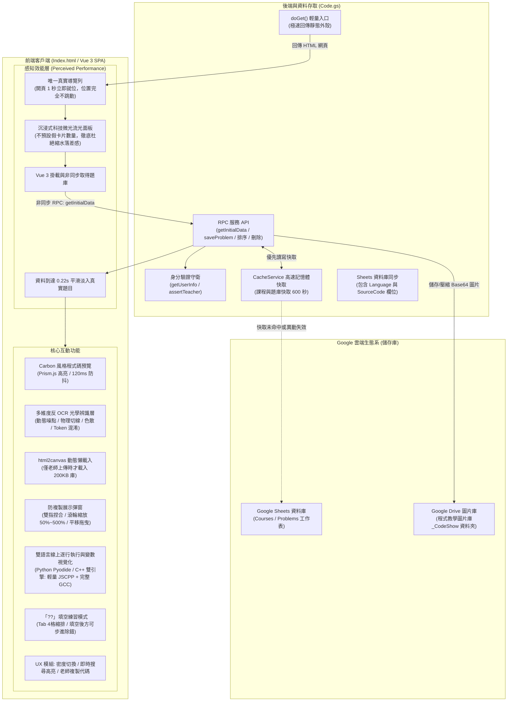

# 程式設計教學展示系統 (CodeShow) 系統架構與部署指南

本專案專為程式教學設計，基於 **Google Apps Script (GAS) + Google Sheets + Google Drive + Vue 3 單頁應用 (SPA)** 架構，兼顧極致的**防抄襲防 OCR 保護**、**秒級感知效能載入體驗**與**零伺服器維護成本**。

---

## 系統整體架構圖



---

## 系統核心特色與技術架構

### 1. 🚀 極速感知載入架構 (Perceived Performance)
為了解決 Google Apps Script (GAS) 伺服器冷啟動 (Cold Start) 帶來的 3~5 秒白畫面等待感，同時完美克服學校電腦教室「硬體還原卡每次開機清空快取」的教學痛點，系統實作了**現代化感知效能與微光佔位架構**：
* **反轉 `doGet()` 負載（1 秒內極速回傳外殼）**：
  * `doGet()` 專注於極速回傳靜態網頁外殼，不進行阻塞型的 Sheets 同步讀取，首包響應時間由原本的 3~5 秒驟降至 ~1 秒。
  * 頂部真實導覽列（💻 程式設計教學展示庫）、搜尋框與密度切換按鈕在開頁第 1 秒就位，使用者立即獲得明確視覺反饋，告別漫長白畫面。
* **沉浸式微光流光同步面板 (Glow Sweep Placeholder)**：
  * **不預設假卡片格數**：傳統骨架屏若預留 6 張，遇到只有 3 題的課程會產生「內容縮水被吃掉」的視覺落差。本系統改採全幅深色流光微光面板（「正在載入課堂題庫... 同步最新教學範例程式碼」），絕不給大腦過度承諾。
  * **還原卡零落差適應**：學校電腦教室每次開機即使清空快取，學生一開頁皆以極具科技感的紫色掃光動態呈現，資料抵達後以 `0.22s` 平滑淡入 (`animate-content-in`) 展開真實題目，不管是 3 題還是 7 題皆呈現「內容浮現」的豐富感，達到 100% 零跳動。
* **CacheService 記憶體快取加速**：
  * 後端透過 `CacheService.getScriptCache()` 將課程與題目目錄快取 10 分鐘 (600 秒)，並設有 100KB 容量保護機制。
  * 當老師執行**新增題目、刪除題目、調整排序、增刪課程**時，自動呼叫 `clearSystemCache()` 精準失效快取，兼顧高速與資料一致性。
* **函式庫按需懶載入 (Lazy Load on Demand)**：
  * 將高達 200KB 的截圖庫 `html2canvas.min.js` 自首頁靜態資源移除。
  * 佔比 95% 以上的純閱讀學生端永遠不需要下載該函式庫；僅在老師開啟「➕ 上傳程式碼」彈窗時，由 `ensureHtml2CanvasLoaded()` 動態注入腳本非同步預熱載入。
* **單次整合 RPC (getInitialData)**：
  * 將傳統「身分驗證 $\to$ 讀取課程 $\to$ 讀取題目」的 3 次遠端往返整合為一次原子呼叫，極致減少連線 Handshake 開銷。

---

### 2. 🛡️ 7 重反 OCR 光學字元辨識系統（瓦解 Google 智慧鏡頭 / iOS 原況文字）
為了確保學生親手敲打鍵盤練習以達到教學成效，程式碼轉成圖片時預設採用**強力防護等級**：
1. **動態微噪點圖層 (Dynamic Noise Layer)**：隨機生成不規則彩色噪點與高頻針刺微短線，破壞固定去噪捲積濾鏡 (Denoising Filters)。
2. **文字微扭曲與基線微傾斜 (Text Warp & Skew)**：加入非線性微小傾斜（`rotate 0.18deg, skewX -0.35deg`），肉眼無感但打亂 OCR 垂直行切分與水平基線演算法。
3. **前置穿透式雙向物理切線 (Cut-lines)**：以 37° 與 127° 雙向微細柵線覆蓋切割字符筆畫，截斷字母連通組件。
4. **雙向色散微重影 (Chromatic Aberration)**：打散字體邊界漸層，使邊緣二值化失準。
5. **偽字符混淆網 (Ghost Tokens)**：在行距與背景散佈隨機微縮字符，稀釋神經網絡注意力權重，使 OCR 提取出亂碼語法。
6. **非線性漸層遮罩 (Vignette Mask)**：打破影像全域與局部 Otsu 二值化閥值。
7. **穿透式重複中文浮水印**：多道斜向浮水印橫跨程式碼，中英文 Token 混淆。
* 支援「強力防護 / 標準防護 / 關閉」一鍵切換與「🎲 隨機變換干擾噪點」按鈕。

---

### 3. 🔒 身分驗證與伺服器端資安架構
* **自動比對 Google 帳號**：
  * 利用 `Session.getActiveUser().getEmail()` 取得訪客帳號，比對試算表擁有者 (Owner) 或 `ADDITIONAL_TEACHER_EMAILS` 授權清單。
  * 老師本人開啟自動進入「👨‍🏫 老師管理模式」，無須手動輸入任何帳號密碼。
* **後端嚴格防護守衛 (`assertTeacher()`)**：
  * 所有寫入操作（`addCourse`、`deleteCourse`、`saveProblem`、`updateProblemsOrder`、`deleteProblem`、`deleteChapter`）在進入後端邏輯的第一行均強制執行 `assertTeacher()`。
  * 即便學生端透過瀏覽器開發者工具 (DevTools) 嘗試直接調用 `google.script.run`，也會直接被 GAS 後端拋出例外攔截，安全性堅固。

---

### 4. 🎨 使用者體驗 (UX) 與展示設計
* **圖片放大檢視與自由平移 (Zoom & Pan)**：
  * 彈窗支援滑鼠滾輪縮放（50% ~ 500%）、觸控雙指捏合手勢縮放、按住滑鼠任意拖曳平移。
  * 附帶「💡 手勢說明」指引卡片，點擊「我知道了」能即刻關閉，操作不衝突。
* **智慧章節排序與時間由舊到新**：
  * 自動解析中文數字（「一、」、「十、」）與阿拉伯數字編號排序章節。
  * 同章節內題目依進度由舊到新排列，並支援老師點擊「◀ / ▶」按鈕一鍵調換順序，即時同步試算表。
* **即時搜尋關鍵字高亮**：輸入關鍵字時，題號與章節名稱自動亮黃色高亮標記匹配字串。
* **卡片顯示密度自由切換**：提供「🔲 緊湊（一列 ≥5~6 題）」與「🔳 舒適」雙模式，自動保存偏好於 `localStorage`。緊湊模式卡片頂部採**兩列佈局**：題號 + ✏️ 佔第一行完整顯示，管理按鈕群靠左排列於第二行；底列縮小字體以單行呈現「檢視 / 複製代碼 / 日期」，整體高度增量極小。
* **智能 WebP 極致壓縮與滑鼠懸停預載 (Hover Preload)**：
  * **現代 WebP 格式輸出**：發布時前端自動以雙三次平滑縮放與 WebP 格式（品質 0.82、最適寬度 1200px）進行壓縮，相較原本 JPEG 體積再縮減 60%~70%，每題程式碼圖壓至僅 ~20-35KB，且字體依然銳利分明；瀏覽器不支援時自動無縫回退至 JPEG。
  * **滑鼠懸停預載**：學生或老師將滑鼠游標移至題目卡片時，立即透過 `@mouseenter="preloadProblemImage"` 提前在背景抓取圖片快取，徹底消弭 Google Drive 轉址延遲，點開彈窗瞬間秒開！
* **輕量 Toast 通知**：採用非阻塞的 Toast 提示取代原生 `alert()`，提升老師連續上傳與排序的操作流暢度。

---

### 5. ⚡ 雙語言線上逐行執行與變數視覺化引擎 (Visual Step Debugger)
為了讓學生擺脫死背程式碼、深入理解演算法內部記憶體狀態與迴圈運作流程，系統具備純前端瀏覽器本地沙盒執行引擎：
* **Python 與 C++ 雙語言自適應切換**：
  * **Python**：按需懶載入輕量 WebAssembly 直譯器 **Pyodide**，透過 `sys.settrace` 即時攔截行號與局部變數。
  * **C++**：按需懶載入純前端 C++ 直譯器 **JSCPP**，藉由 AST 樹 `nextNode().sLine` 精準獲取執行游標，並內建 `int main()` 遺漏 `return 0;` 與未初始化 `NaN` 的安全容錯修正；**內建 `<algorithm>` / `<bits/stdc++.h>` 零行號偏移同列相容補丁**，原生支援極為常用的 `min`、`max`（支援 `int`、`double`、`float`、`char`），若學生僅宣告 `<bits/stdc++.h>` 而未額外寫 `<iostream>`，系統智慧優先同列映射為 `<iostream>` 並於命名空間後方注入 `min`/`max`，確保 `cin`/`cout` 與演算法函式雙向就位，徹底解決輕量直譯器報出 `cannot find library:algorithm` 或 `cin does not exist` 的相容性障礙。
  * **完全零伺服器開銷**：全於訪客瀏覽器本地記憶體運算，不耗損 Google Apps Script 執行時間額度。
* **左欄嚴格防複製代碼行高亮與長行自動折行 (Word Wrap)**：
  * 當前執行行以 **藍紫色高亮與指針 ▶** 標示並自動捲動置中；已執行過的行維持高亮，未執行行淡化。
  * **長程式碼自動折行**：頂部提供「`↩ 自動換行 / 不換行`」雙態按鈕（預設開啟自動折行），即使視窗縮小或程式碼邏輯很長（如多條件判斷式），也能自然折行完整呈現，免去橫向手動拉動捲軸；折行時行號指針置頂對齊、填空框流暢自適應排列。
  * **全域禁用程式碼連字 (Disable Font Ligatures)**：設定 `font-variant-ligatures: none`，確保 `<=`, `>=`, `!=`, `==`, `->` 等運算子還原為各自獨立原始符號，避免字型合字將 `<=` 渲染為數學符號 `≤` 造成初學者混淆。
  * 全面套用 `user-select: none` 與停用右鍵，學生無法選取或複製程式碼純文字，維護「動手練習敲打鍵盤」教學宗旨。
* **右欄即時動態變數表 (支援 2D 矩陣陣列與自動滾動)**：
  * **純量型別**：自動識別 `int`、`float`、`bool` 等型別與數值，關閉字型合字避免 `==` 與 `=` 混淆。
  * **1D 陣列 / 串列**：以橫向索引標籤表格排列。
  * **2D 二維矩陣陣列**：以網格矩陣對齊渲染，當迴圈修改單元格時，該格以**橘色動態平滑淡出（消除次像素回彈抖動，透過 `box-shadow: inset` 確保四邊框線完整不被吃線）**提示修改點。
  * **自動滾動至更新變數**：變數數量較多時，每一步自動平滑捲動到「剛更新」變數列，並微調終端輸出高度以完整舒適呈現 5 個變數。
  * **⚠️ C++ 未初始化變數擬真隨機殘留值 (Undefined Behavior 模擬)**：
    * 針對宣告後未賦值的區域變數，摒棄傳統無感強制歸零做法，改由典型記憶體殘留樣本庫隨機抽取數值（例如 `32767`, `-858993460`, `42718` 等，亦含極低機率為 `0`），並以醒目標籤 `⚠️ 未設初值 (隨機殘留值)` 提示學生。
    * **就地自訂初值即時重新模擬 (Interactive Memory Simulation)**：點擊數值或 `[✏️ 改初值]` 按鈕可即時切換微型輸入框（支援 Enter 確認、Esc 取消）。老師可直接將變數改成 `0`（或其他特定邊界值），系統於 0.02 秒內完成無感重新預錄並精準停留在當前步驟，按「下一步」時底層真實依自訂初值執行（例如條件判斷判定為 false 直跳結尾），課堂可一鍵現場演示「若記憶體剛好殘留 0 則程式直接出錯崩潰」的教學場景。
  * **過濾 C++ 執行期 `main`、`min`、`max` 函式符號**：自動排除解譯器內部 AST 的全域函式符號與系統識別字，確保變數表乾淨純粹只呈現程式真正的變數。
  * **C++ 原生陣列安全反序列化與跨 Scope 區域變數捕獲**：解決 JSCPP 對陣列輸出字串格式 `"[0, 5, 3, NaN, ...]"` 導致型別被誤判為 `str` 且充滿 `NaN` 的問題，透過 `parseCppArrayValue()` 安全還原為原生 JavaScript Array 並將未初始化的記憶體殘留 `NaN` 自動清洗為正規 `0`，還原 1D 陣列表格排版；即時運算監看式（Watch）同步恢復對 `h[i]`、`h[i-1]`、`h[i+1]` 的精準元素取值與 C++ 越界守衛；同時實作跨 Scope 主動識別字搜尋，確保 `for` 迴圈區域變數（如 `i`, `j`）即使處於巢狀區塊中依然精準呈現於變數表與即時監看式範疇。
* **🔍 浮動可拖曳式即時運算監看面板 (Watch Expressions)**：
  * **自由運算式即時求值**：允許學生自訂輸入多個運算式（例如：`b*b - 4*a*c`、`x + y`、`i < n`、`Math.sqrt(d)` 等），並於每一步執行時由 `Function` 沙盒動態注入當前所有變數值求值，即時顯示計算結果或布林值。
  * **語言感知陣列代理 (Language-Aware Array Proxy)**：
    * **Python 模式**：完整支援負數索引（如 `h[-1]`、`h[i-1]`），不但能正確計算出末尾元素值（並可參與後續運算如 `min(h[i-1], h[i+1])`），數值旁更即時浮現 `⚠️ [負數索引 h[-1] ➜ 取得末尾元素 h[8]]` 提示標籤，課堂上可直觀示範「語法雖然有值但邏輯上繞到尾巴」的經典 Bug；若超出範圍（例如 $i=n-1$ 時取 `h[i+1]`）則精準拋出 `IndexError: list index out of range`，徹底消滅 JavaScript `undefined` 的語言滲漏。
    * **C++ 模式**：嚴格遵循記憶體連續存取規範，任何索引 `< 0` 或 `>= length` 立即提示 `⚠️ C++ 陣列越界: 索引 [-1] 超出合法範圍 0 ~ 8`，幫助學生建立扎實的邊界檢查觀念。
    * **跨語言型別美化**：布林值依語言自動呈現 Python 的 `True` / `False` 或 C++ 的 `true` / `false`；空值自動轉為 `None` / `nullptr`；未宣告變數精準報出 `NameError` 或 `未宣告的識別字`。
  * **自由拖曳不遮擋**：採用浮動覆蓋層設計，附帶拖曳把手，可自由拖曳至螢幕任意位置或外側背景，寬螢幕下絕不壓縮變數表空間；提供「歸位」按鈕可一鍵重置至右上角預設錨點。
  * **本機儲存與同步**：監看運算式清單自動儲存於 `localStorage`，重新整理或換題後設定不丟失。
  * **支援雙環境**：在題庫除錯與自由沙盒兩處皆具備「🔍 監看式」切換按鈕，體驗完全一致。
* **標準輸出 (stdout) 支援橫向排版與最新輸出鮮明標示**：
  * **最新輸出鮮明高亮**：逐步執行過程中，最新一行印出的輸出以醒目的 **琥珀金色 (Amber) + `▶` 指針** 獨立標註，與歷史輸出的翡翠綠色做出極高辨識度區隔，學生能一眼看清當前步驟的輸出變化。
  * 支援長排版（如九九乘法表）與末尾自動平滑捲動至最新輸出，執行到底時自動平滑回滾至頂部方便由第一行開始核對標準答案。
* **📥 輸入資料區 (stdin) 動態行追蹤串流**：
  * 尚未執行前提供預設 7 行多行文字框，支援貼上批次測資；
  * 逐步執行中動態切換為「**輸入串流追蹤**」，以高對比青色游標 `▶ 剛讀入` 與綠色 `✓ 已讀入` 即時標記目前程式碼吃掉了第幾行資料，亦可隨時切回檢視原始文字；
  * **按「🔁 重新開始」智慧開放更換測資**：按下重新開始後，系統清空歷史追蹤快取並還原至準備就緒狀態，輸入框自動恢復為可編輯狀態並保留既有測資內容，方便學生與老師隨時修改數值再次驗證，並在下次步進時自動以新測資重新追蹤。
* **🎛️ 觀測區 vs. 操作控制台 專屬立體分界欄**：
  * 明確劃分「👁️ 上半部程式與變數觀測區」與「🎮 下半部測資輸入與步進操作控制台」，搭配高對比邊界飾條、立體下沉陰影與步驟進度指示，建立清晰直覺的教學心智模型。
* **🎮 2×3 六宮格步進控制面板 (中斷點 ＆ 動態自動執行 ＆ 跨列方形退出鍵)**：
  * **頂部整合控制列（左側 2 列資訊 + 右側跨 2 列方形退出鍵）**：
    * **Row 1（進度與動態狀態）**：`執行步驟: X / Y` ｜ `● 逐步追蹤中 / ⚡ 自動執行中... / ✓ 已執行結束`
    * **Row 2（工具與調速）**：`🕹️ 步進控制(Controls):` ｜ `[ 0.5x | 1x | 2x ]` 速度膠囊 ｜ `[ 🔴 清除中斷點 (N) ]`
    * **右側跨 2 列方形大按鈕（Thonny STOP 心智重現）**：
      * **沙盒模式**：**`[ ⏹️ 停止除錯 / 返回編輯 ]`**（深邃暗紅微光，結束時帶呼吸光環，一鍵退回代碼編輯）
      * **題庫模式**：**`[ ⏹️ 停止除錯 / 返回圖片 ]`**（深邃暗紅微光，一鍵切換回原題目圖片）
      * 支援鍵盤 **`Esc`** 快速鍵一鍵退出除錯回到主檢視。
  * **主體 2 列 × 3 欄 (2×3) 勻稱方格排版**，等高 `154px` 與左側測資輸入完全對齊：
    * **上排（輔助與自動）**：`[ 🔁 重新開始 ]` `[ ◀ 上一步 ]` `[ ⏯️ 自動執行 / ⏸️ 暫停執行 ]`
    * **下排（前進三階梯）**：`[ ▶ 下一步 (單步) ]` `[ 🎯 執行到中斷點 (跨段) ]` `[ ⏩ 執行到底 (全部) ]`
  * **🔴 中斷點 (Breakpoints) 系統**：
    * **點擊行號設中斷點**：滑鼠懸停於行號區浮現淡紅空心圈 `○`，點擊即標註鮮紅實心圓 `●` 與微光陰影，整行微顯淡紅底色；再次點擊取消。
    * **`[ 🎯 執行到中斷點 ]`**：單次點擊精準跳躍至下一個命中的中斷點行；若設於迴圈內部，每次點擊剛好跳躍至下一輪迭代，大幅節省課堂步進時間；後續無中斷點時平滑執行到底並提示。
    * **`[ 🔴 清除中斷點 (N) ]`**：標題列動態顯現一鍵全清按鈕，無中斷點時自動隱藏，兼具單點取消與一鍵全清。
  * **⚡ 自動執行 (Auto-Play) ＆ 三段速度微型膠囊**：
    * **自動步進動畫**：點擊「自動執行」後以動畫節奏自動步進，按鈕轉為呼吸光與「暫停執行」；遇到中斷點或結束時自動精準煞車暫停，暫停後秒切回「自動執行」，所有 6 顆按鈕隨時任意自由操作。
    * **三段速度切換 (Speed Pill)**：標題列內建 `[ 0.5x (慢速1.5s) | 1x (標準0.8s) | 2x (快速0.3s) ]` 微型膠囊，支援執行中即時調速，並自動儲存偏好於 `localStorage`。
  * **雙模 100% 同動**：題庫逐行除錯與自由練習沙盒兩處皆具備完全相同的六宮格按鈕、跨列退出鍵、中斷點行號點擊與調速膠囊。
* **📐 視窗大尺寸寬螢幕自適應與左右對稱**：
  * 逐行執行視窗擴展為 `max-w-6xl xl:max-w-7xl` 與 `92vh`，左側程式碼欄與右側變數/終端欄採 6/12 + 6/12 精準左右對稱，空間利用率極佳，大螢幕不再感到侷促或留白過大。
* **✏️ 「??」填空練習模式**：
  * 原始碼含有 `??` 或 `????` 時自動轉化為黃色虛線填空框。
  * **支援 `Tab` 鍵 4 格縮排**：在填空框按 `Tab` 鍵自動插入 4 個空格，精確訓練 Python 縮排與語法結構；填妥所有空格後才可進入逐步除錯。
* **🖍️ 「@@」易錯與關鍵語法高透亮螢光黃劃線標記模式**：
  * 老師在上傳程式碼時，可於關鍵易錯語句前後加上「@@」（例如：`range(1, @@n-1@@)` 或 `ans += @@min(h[i-1], h[i+1])@@`）。
  * **無邊框清澈亮黃螢光**：採用高明度、高飽和度的經典螢光筆亮黃（`rgba(253, 224, 71, 0.75)`），在深黑底上鮮亮清透、完全告別暗沉髒濁；並在 html2canvas 轉圖流程中透過 `document.fonts.ready` 與 `onclone` 自動消除 OCR 扭曲矩陣干擾與字型 baseline 誤差，達成文字 100% 絕對垂直對稱包覆，徹底根除色塊上浮與文字削底。
  * **逐行除錯零衝突純化**：儲存於 Sheets 之原始碼完整保留「@@」標記供備課複製；當送入 Python/C++ 直譯器執行時，系統自動將「@@」剝除還原為乾淨代碼，除錯畫面左側同步以螢光高光呈現，保證 100% 正常編譯運行。
* **🚨 獨立錯誤訊息診斷面板 (Error Diagnosis Panel)**：
  * 當學生填寫之程式碼發生語法錯誤或執行期例外時（例如 Python 括號未閉合、遺漏冒號、縮排錯誤、未定義變數；C++ 遺漏分號、未宣告型別等），系統徹底摒棄瀏覽器原生卡死的 `alert()` 彈窗。
  * 改於**程式碼正下方**獨立展開診斷面板，並在出錯行標示 💥 警示紅底並自動滾動至該行。
  * 自動過濾直譯器多餘的內部追蹤堆疊，並自動轉換為淺顯易懂的繁體中文教學提示（例如：「💡 缺少冒號 ':'，在 if、for 等陳述句末尾需加上冒號」），引導學生自我除錯。
* **💥 執行期錯誤 (Runtime Error) 崩潰前步驟完整保留與單步回溯除錯 (Post-Mortem Step Debugging)**：
  * **智慧區分「語法錯誤」與「執行期例外」**：
    * **語法錯誤 (SyntaxError)**：無法編譯執行，進入除錯時立即精準標註語法錯誤行號與繁體中文修復建議。
    * **執行期錯誤 (Runtime Error)**：如 Python 的 `IndexError`、`ZeroDivisionError`、`TypeError` 或 C++ 記憶體陣列越界等。系統徹底擺脫傳統除錯器「一遇到例外就整段崩潰、丟棄全部步驟」的缺點，**完整保留程式崩潰前產生的所有歷史步驟與變數狀態**！
  * **親歷演算法邊界陷阱 (如 APCS g595 修繕籬笆)**：
    * 學生在測試包含邊界瑕疵的程式碼時（如 `total += min(h[i-1], h[i+1])`），系統能讓學生**一步步真實前進**。
    * 在 Python 環境下，學生能親眼看見 `i = 0` 時 `h[-1]` 循環存取最後一個元素而**未拋出異常**（生動揭示 Python 負索引的隱性邏輯 Bug）；直到迴圈推進至 `i = 8`、存取 `h[9]` 超出串列長度時，系統才在第 25 步精準亮起 **`💥` 指針與紅色錯誤行**！
  * **時光倒流回溯（◀ 上一步）**：
    * 程式崩潰時自動煞車暫停並展開下方診斷面板。此時學生可隨時點擊「◀ 上一步」回到前一動，紅框自動收斂、指針還原為藍色 `▶`，方便學生來回比對崩潰前一刻的記憶體變數，快速釐清在迴圈第幾輪、哪一組變數數值下觸發了邊界錯誤。
  * **雙引擎雙環境 100% 同動**：題庫逐行除錯與自由沙盒雙雙支援 Python (Pyodide) 與 C++ (JSCPP) 的崩潰前步進保留機制。
* **🙈 圖卡「隱藏 / 顯示」色盲無障礙友善設計 (藍底 vs. 紅底)**：
  * 針對色盲（紅綠色盲等）友善辨識，首頁卡片與按鈕全面採用高對比藍紅雙色體系：
    * **顯示狀態**：圖卡採用沉穩的**藍色系底色 (`bg-blue-950/40`)**、藍色邊框與藍色題號標籤，管理按鈕標示為鮮明**藍色 (`bg-blue-600`)**。
    * **隱藏狀態**：圖卡採用**紅色底色 (`bg-red-950/45`)**、紅色虛線邊框與紅色標籤，管理按鈕標示為**紅色 (`bg-red-600`)**。
  * 徹底摒棄傳統紅綠混淆配色，紅藍對比鮮明強烈，極易辨識；切換為隱藏後學生端自動過濾題目（防止跨班偷看劇透答案），老師端則維持紅底虛線邊框方便隨時切換。
* **👁️ 老師下課「一鍵批次顯示全部」 (下課防偷看秒解鎖)**：
  * 當前課程中若有被隱藏的題目，首頁頂部動作列會即時亮起藍色按鈕 **`[ 👁️ 顯示全部 (已隱藏 N 題) ]`**。
  * 下課時老師只需點擊一次並確認，前端立即**樂觀更新（所有題目秒變藍底顯示，按鈕智慧自動隱藏）**，後端透過單次批次呼叫 `batchShowAllProblems()` 在 0.1 秒內完成 Sheets 資料表更新與快取刷新，杜絕逐題手動切換的繁瑣，讓學生下課後能立刻自主練習。
* **✏️ 圖卡題號與章節資訊微型編輯彈窗 (Problem Info Edit Modal)**：
  - **零版面破壞與寬敞輸入**：徹底解決以往題號就地長條展開導致空間狹窄破版問題；點擊 ✏️ 按鈕即彈出輕量級微型對話框，題號與章節均有寬敞輸入環境。
  - **題號與章節一站式修改**：
    - **題號修改**：自動全選文字，支援按鍵盤 `Enter` 快速確認，支援同課重號雙重嚴格阻擋。
    - **章節搬移**：提供下拉選單列出課程所有現存章節（點擊一鍵移動），並支援一鍵切換為「➕ 自訂新章節」輸入全新章節名稱。
  - **極速樂觀更新與雲端同步**：確認儲存後前端瞬間樂觀重組章節群組（`groupedChapters` 自動重新分組與排序），後端透過 `updateProblemInfo` 同步更新 Google Sheets 第 2 欄 (Chapter) 與第 3 欄 (ProblemNo)，並對 Google Drive 圖片檔案自動重命名為 `course_chapter_problemNo.ext`，無須重新上傳。
* **🗑️ 刪除按鈕改為 SVG 垃圾桶圖示**：
  * 原  刪除按鈕改為內嵌 SVG 垃圾桶（），語意清楚不易與「關閉視窗」混淆。
  * hover 效果：整顆按鈕變紅底白圖（），危險操作視覺反饋明確。
  * 外觀與 ◀ ▶ 按鈕一致（ 框線）。
* **📅 日期固定靠右對齊**：
  * 題目卡片底列日期以  固定於最右端，對齊上方刪除按鈕，不受「🙈 已隱藏」徽章有無影響。
  * 「🙈 已隱藏」徽章位置自適應密度：緊湊模式顯示於題號行，舒適模式顯示於底列日期前。
* **👨‍🏫 老師管理複製原始碼**：
  * 題目卡片為老師提供「📋 複製代碼」按鈕，支援 iframe 剪貼簿 fallback，方便老師快速取用修改。
* **🪄 老師上傳彈窗「一鍵排版美化」**：
  * 在貼上程式碼區域配置「🪄 美化排版」快捷鍵，支援 C/C++ 嚴格 1TBS（左大括號同列、`else/catch` 同列、4 格縮排）與 Python PEP 8 規範，並完美保留 `??` 填空標籤。
  * 點擊後即刻連動下方的 Prism.js 語法高亮與動態防 OCR 噪點重繪，產出格式工整、賞心悅目的 Carbon 程式碼卡片。

---

## 專案檔案清單

| 檔案名稱 | 角色 | 說明 |
|---|---|---|
| [`Code.gs`](file:///Users/lincube/Documents/show_code/Code.gs) | 後端控制層 (GAS) | 負責入口 `doGet()`、身分鑑權、快取、Sheets 欄位擴充 (含 Language 與 SourceCode)、圖片生命週期管理。 |
| [`Index.html`](file:///Users/lincube/Documents/show_code/Index.html) | 前端表現層 (SPA) | 內含 HTML、Vue 3、Prism.js、Pyodide/JSCPP 雙語言逐步執行器、變數表矩陣渲染器、anti-OCR 圖片檢視器、自由練習沙盒雙模系統。 |
| [`Code.gs.v3_sandbox`](file:///Users/lincube/Documents/show_code/Code.gs.v3_sandbox) | 歷史版本存檔 (v3.0) | 第三版自由練習沙盒與即時監看式穩定版本後端存檔。 |
| [`Index.html.v3_sandbox`](file:///Users/lincube/Documents/show_code/Index.html.v3_sandbox) | 歷史版本存檔 (v3.0) | 第三版自由練習沙盒與即時監看式穩定版本前端存檔。 |
| [`Code.gs.v2_debug`](file:///Users/lincube/Documents/show_code/Code.gs.v2_debug) | 歷史版本存檔 (v2.0) | 第二版題庫逐行除錯後端存檔。 |
| [`Index.html.v2_debug`](file:///Users/lincube/Documents/show_code/Index.html.v2_debug) | 歷史版本存檔 (v2.0) | 第二版題庫逐行除錯前端存檔。 |
| [`Code.gs.v1_image_only`](file:///Users/lincube/Documents/show_code/Code.gs.v1_image_only) | 歷史版本存檔 (v1.0) | 原始純圖片展示與管理後端（無原始碼欄位儲存）。 |
| [`Index.html.v1_image_only`](file:///Users/lincube/Documents/show_code/Index.html.v1_image_only) | 歷史版本存檔 (v1.0) | 原始純圖片防複製預覽與 Carbon 轉圖前端。 |
| [`README.md`](file:///Users/lincube/Documents/show_code/README.md) | 說明文檔 | 系統架構、逐步除錯器技術細節、防 OCR 策略、部署指南。 |

---

## 完整部署與更新指南

### 第一次全新部署

1. **建立 Google 試算表**：
   * 前往 [Google Sheets](https://sheets.new/) 建立一份空白試算表，命名為 `程式教學題庫管理系統`。
2. **開啟 Apps Script 編輯器**：
   * 選取上方選單 **「擴充功能」 $\to$ 「Apps Script」**，專案名稱可設為 `CodeShow_System`。
3. **貼上原始碼**：
   * 將本專案的 [`Code.gs`](file:///Users/lincube/Documents/show_code/Code.gs) 內容貼入後端檔案（如有多位授課老師，可於 `ADDITIONAL_TEACHER_EMAILS` 填寫其 Email）。
   * 點選 **「+」 $\to$ 「HTML」**，建立名為 **`Index`** 的檔案，貼入 [`Index.html`](file:///Users/lincube/Documents/show_code/Index.html) 的內容。
4. **首次授權與資料表初始化**：
   * 編輯器頂部函式選取 **`initSpreadsheet`**，點擊 **「執行」**。
   * 依瀏覽器指示完成 Google 帳號授權；執行完畢後 Sheets 會自動產生 `Courses` 與 `Problems` 兩個工作表，Google Drive 會自動建立圖片資料夾。
5. **部署為 Web 應用程式**：
   * 點擊右上角 **「部署」 $\to$ 「新增部署作業」**。
   * 類型選取 **「網頁應用程式」 (Web app)**。
   * **執行身分 (Execute as)**：選取 **`我 (Me)`**。
   * **誰可以存取 (Who has access)**：
     * **校內使用**：選取 `[您的網域] 內的任何人`。
     * **跨校/公開分享**：選取 `所有已登入 Google 帳號的人`（因後端有 `assertTeacher()` 保護，學生僅具讀取權限，安全性無虞）。
   * 點擊 **「部署」** 並複製產生的「網頁應用程式網址 (URL)」。

---

### 日常程式碼修改後的更新步驟 (重要 ⚠️)

Google Apps Script 的網頁應用程式在修改程式碼後，**單純按儲存不會反映到線上正式環境**，請務必按照以下步驟更新：

1. 在 Apps Script 編輯器中覆蓋貼上修改後的程式碼並存檔。
2. 點選右上角 **「部署」 $\to$ 「管理部署作業」 (Manage deployments)**。
3. 點選左側目前的正式部署項目，點選右上角的 **✏️「編輯」 (鉛筆圖示)**。
4. **版本 (Version)** 下拉選單選擇 **「新版本」 (New version)**。
5. 點擊 **「部署」**。此時線上發布的網址保持不變，但程式碼與骨架畫面即刻生效！

---

### 6. 🧪 自由練習沙盒 ＆ 線上輕量編譯/逐行除錯雙模系統 (v3.0)

#### 1. 功能願景與教學價值
現行系統的逐行可視化除錯器專注於展示老師建立的題庫範例。為了延伸課堂學習成效，系統於首頁頂部動作列配置了**「🧪 自由練習沙盒」**入口，讓學生不僅能看範例，還能隨時貼上自己的隨堂練習、作業或測試程式碼，直接在瀏覽器進行免安裝環境的**「⚡ 線上編譯執行 (Direct Run)」**與**「🔍 視覺化逐行除錯 (Step Debugger)」**。

#### 2. 單一模組共用核心 (Single Source of Truth)
* **底層直譯引擎 100% 共用**：沙盒與題庫完全共用純前端 WebAssembly 沙盒（Python 的 Pyodide 追蹤器與 C++ 的 JSCPP AST 執行器），零伺服器運算負載。
* **視覺化元件 100% 共用**：變數動態監控表（含 2D 矩陣單元格閃爍）、標準輸出終端（含最新輸出琥珀金標註）、輸入資料串流行追蹤、錯誤診斷面板與步進狀態機完全由同一組 Vue 狀態與樣式驅動。
* **無縫維護性**：未來任何視覺或除錯器功能升級（例如新增型別支援、字型微調、排版調整），只要修改一處，題庫除錯與自由沙盒兩邊將同時生效，杜絕雙頭維護問題。

#### 3. 統一四宮格佈局（左側 Input / 右側 Output）
徹底解決傳統線上編譯器「輸入放右邊」與逐行除錯「輸入放下方」造成的元件跳動困擾，統一採用**「左側專注 Input（代碼＋測資），右側專注 Output 與操作」**的清晰認知架構：

| 區域 | 左側 (Input 端：代碼與測資) | 右側 (Output 端：觀測與操作) |
|---|---|---|
| **上半部 (觀測區 6/12)** | **左上：程式碼區**<br>• 編譯模式：自由編輯輸入框 (等寬字型、Tab 4格縮排、行號)<br>• 除錯模式：帶指針 ▶ 的逐行高亮行 (支援長行自動折行) | **右上：輸出與狀態區**<br>• 編譯模式：全幅 **📤 標準輸出 (stdout)**，寬敞便於對答案<br>• 除錯模式：上半部變數表 (含 2D 矩陣) ＋ 下半部標準輸出 |
| **中　間** | ──── 🎛️ 觀測區 vs. 操作控制台 專屬立體分界欄 ──── | ──────────────────────── |
| **下半部 (操作區 6/12)** | **左下：📥 輸入資料 (stdin)**<br>• **永遠固定在左下方**，切換模式位置完全不跳動！<br>• 支援貼上多行測資，除錯時可無縫切換為串流行追蹤游標<br>• **按「🔁 重新開始」自動恢復可編輯狀態**：重置為準備就緒狀態並完整保留既有測資，隨時修改後下一步自動重新追蹤！ | **右下：互動控制按鈕區**<br>• 編譯模式：**`[ ⚡ 直接執行 (Run) ]`** 與 **`[ 🔍 進入逐行除錯 ]`**<br>• 除錯模式：<br>  - 頂部控制列：左側雙列資訊 (步驟/狀態 + 調速/中斷點) ＋ 右側跨列方形鍵 **`[ ⏹️ 停止除錯 / 返回編輯 ]`** (支援 `Esc` 快捷鍵)<br>  - 2×3 六宮格：上排 **`[ 🔁 重新開始 ]` `[ ◀ 上一步 ]` `[ ⏯️ 自動執行 ]`** ｜ 下排 **`[ ▶ 下一步 ]` `[ 🎯 到中斷點 ]` `[ ⏩ 執行到底 ]`** |

#### 4. 頂部工具列核心功能設計
1. **🌐 語言切換選單 (Python (Pyodide) / C++ (JSCPP、GCC))**：
   * 採中央絕對置中 (`absolute left-1/2 -translate-x-1/2`) 醒目大膠囊排版，與題庫「圖片模式 / 逐行執行」同規格、採**嚴格雙鍵等寬對稱**（標註具體編譯核心 `Python (Pyodide)` 與 `C++ (JSCPP、GCC)`，兩側字數均勻平衡，且讓學生清楚知曉具備輕量與完整 2 種 C++ 編譯引擎；中間 6px 間距精確垂直對齊下層 50% 編輯器與輸出終端之縱向分隔線）、同立體陰影與字體階級。
   * 具備雙語言獨立草稿快取，切換語言時自動保留並載入各自程式碼，不互相覆蓋；除錯中自動禁用防止狀態混亂。
2. **🪄 魔術棒按鈕 (自動調整縮排與排版美化)**：
   * **C++ (嚴格 1TBS / OTBS - "One True Brace Style")**：
     * 左大括號 `{` 統一保持在陳述句同列結尾（包含函數宣告 `int main() {`、`if (...) {`、`for (...) {`）。
     * `else`、`catch` 與前一個右大括號保持同一行：`} else {`、`} else if (...) {`。
     * 自動以標準 4 格空格進行階層式縮排，並清理行尾多餘空白。
   * **Python (PEP 8 規範)**：
     * 將所有 Tab 統一轉為 4 格空格。
     * 依據冒號結尾（`def`, `class`, `if`, `elif`, `else`, `for`, `while`, `try`, `except`）自動遞增縮排，並依據 `return`, `break`, `continue`, `pass` 智慧退格。
3. **💾 存檔與匯出**：
   * 本機持久化：程式碼編輯即時/手動保存至瀏覽器 `localStorage`，防止學生誤按重整或關閉分頁造成代碼丟失。
   * 檔案匯出：提供「📥 下載檔案」按鈕，依當前語言自動產出 `sandbox.py` 或 `sandbox.cpp` 檔。
4. **⌨️ 智慧鍵盤編輯體驗 (Auto-indent ＆ 語法括號補全)**：
   * **Tab 鍵插入 4 格空格**：全面攔截瀏覽器跳至下個元素的原生 Tab，精準插入 4 格標準空格。
   * **Enter 鍵繼承縮排**：換行時自動延續上一行的前置縮排，告別游標每次重回行首的繁瑣重打。
   * **Python 冒號 `:` 智慧縮排**：當前行末尾為冒號時，換行後自動繼承並額外增加一級（+4 格）縮排，游標直接就位。
   * **C++ 大括號 `{` 智慧補全 (1TBS 規範)**：當前行末尾為 `{` 時，按 Enter 第一個換行縮排 +4 格且游標停駐，下 2 行自動對齊外層縮排補上閉合大括號 `}`；若游標後原本緊鄰 `}` 則自動推至下 2 行，防止重複補出 `}}`。

#### 5. 雙模操作流程體驗
* **模式一：⚡ 一般線上編譯器 (Direct Run)**
  * 學生打完代碼、左下貼好測資，點擊右下角 `[ ⚡ 直接執行 (Run) ]`。
  * 系統於本地直接跑完並於右上角秒出完整 stdout，左側代碼持續可編輯，學生可迅速進行「改代碼 $\to$ 按執行 $\to$ 看輸出」的高速測試循環。
* **模式二：🔍 視覺化逐行除錯 (Step Debugger)**
  * 學生發現輸出不對需要抓 Bug 時，點擊右下角 `[ 🔍 進入逐行除錯 ]`。
  * 畫面無縫切換為單步追蹤，右下按鈕轉為步進控制鍵，右上展開變數表，學生可按「下一步」逐步觀察記憶體與行指針；隨時可按 `[ ✏️ 返回編輯 ]` 跳回模式一修改。

#### 6. 首頁入口位置
* 於首頁頂部導覽列（或檢索功能列）配置顯眼的 **`[ 🧪 自由練習沙盒 / 線上除錯器 ]`** 快捷按鈕，點擊即以大尺寸彈窗展開該模組。

---

### 7. 🛡️ 彈窗防穿透機制與除錯狀態連動規範（架構與維護備忘）

為了提供學生與老師無干擾的除錯與編輯操作體驗，避免常見的誤觸陷阱，系統針對**「題庫卡片彈窗 (activeProblem)」**、**「自由練習沙盒 (showSandboxModal)」**與**「老師發布上傳彈窗 (showUploadModal)」**建立了統一的彈窗行為規範：

#### 1. 滑鼠圈選拖曳防穿透機制 (Selection Drag-out Protection)
* **痛點背景**：在程式碼編輯區、測資輸入框 (stdin)、上傳代碼框或除錯變數表大範圍反白圈選文字時，滑鼠游標常由下往上滑出視窗邊界放開。若外層遮罩具備點擊關閉事件（如 `@click.self`），會誤判定為點擊背景而直接關閉彈窗並返回首頁，導致辛辛苦苦輸入的程式碼或除錯進度意外遺失。
* **統一解決方案**：
  * **完全移除外層背景點擊關閉行為**：題庫彈窗、自由沙盒與老師上傳彈窗的外層全螢幕遮罩一律**不綁定** `@click.self`。
  * **明確唯一的關閉途徑**：彈窗關閉一律透過右上角的明確 `✕` 按鈕觸發，徹底消除任何大範圍選取、滑鼠拖曳出界時的意外關閉。
  * **全域非阻塞雙色 Toast 通知**：廢除瀏覽器原生凍結視窗的 `alert()`，全面整合為支援成功（翡翠綠 `✓`）與錯誤（玫瑰紅 `⚠️`）的動態 Toast 提示系統。

#### 2. 除錯模式退出與鍵盤 Esc 階梯式返回機制
* **痛點背景**：即時運算監看面板 (Watch Expressions) 屬於浮動覆蓋層，當使用者退出逐行除錯模式時，若監看面板依然懸浮於畫面上，容易遮擋視線且失去除錯變數上下文；且使用者在圖片模式或編輯模式時，期望能順手按鍵盤 `Esc` 快速關閉彈窗返回題庫首頁。
* **階梯式 `Esc` 快速鍵導覽架構**：
  * **第一階（除錯模式中）**：按 `Esc` 立即停止除錯並返回前一模式（沙盒模式退回程式編輯器、題庫模式退回原始圖片檢視），同時自動連動關閉監看面板與清除中斷點。
  * **第二階（主檢視中）**：在題庫圖片模式、沙盒編輯模式、上傳彈窗或課程管理視窗下按 `Esc`，直接關閉彈窗跳回首頁。
* **四路退出自動連動**：
  1. **沙盒模式點擊「⏹️ 停止除錯 / 返回編輯」或按 `Esc`**：自動將 `showWatchPanel.value = false`。
  2. **沙盒模式點擊右上角「✕ 關閉彈窗」**：自動將 `showWatchPanel.value = false`。
  3. **題庫彈窗點擊「⏹️ 停止除錯 / 返回圖片」或按 `Esc`**：自動將 `showWatchPanel.value = false`。
  4. **題庫彈窗點擊右上角「✕ 關閉彈窗」**：自動將 `showWatchPanel.value = false`。

#### 3. ⚠️ 開發維護同動原則 (Design Contract)
> **重要規範**：
> 「自由練習沙盒」與「題庫卡片彈窗」在視窗層級控制、全螢幕防穿透遮罩、拖曳選取防護、即時監看面板連動以及底層除錯執行引擎上，**兩者皆視為同等重要的除錯介面**。
> 未來如有任何關於彈窗行為、鍵盤快捷鍵、防誤觸機制或除錯器互動之修改，**必須兩處同時檢視並同步修改**，確保全系統操作心智模型的一致性。

#### 4. 🛡️ 程式碼修改品質門禁與語法防護機制 (Quality & Syntax Guards)
> **歷史教訓與痛點警示**：
> 由於 `Index.html` 採單一檔案（Single File）架構整合 Vue 3 與龐大除錯邏輯，若在編輯局部代碼時因巢狀層級深而意外多留或少吃了封閉大括號 `}`，會導致整段 JavaScript 拋出 `SyntaxError`，進而使得 Vue 應用程式無法成功掛載（Mount），整張網頁將癱瘓呈現未編譯的 Mustache 原始模板（`{{ ... }}`）。
> 傳統的 `<html` 或 `<script` 標籤計數檢查無法抓出 JavaScript 語法錯誤，因此未來任何對話與維護**強制遵守以下兩大防護機制**：

* **機制 1：macOS 原生 JavaScriptCore (`jsc`) 編譯期語法門禁（Mandatory Syntax Check）**：
  * 未來無論是 AI 助手或開發者，在對 `Index.html` 完成任何編輯後、建立 Git Commit 或向使用者回覆前，**強制必須執行真正的 WebKit 核心靜態編譯檢驗**：
    ```bash
    python3 -c '
    import re, subprocess
    with open("Index.html") as f: c = f.read()
    assert c.count("<html") == c.count("</html>") == 1
    assert c.count("<script") == c.count("</script>")
    scripts = re.findall(r"<script(?:\s+[^>]*)?>(.*?)</script>", c, re.DOTALL)
    with open("/tmp/__v_syntax.js", "w") as f:
        f.write("try { new Function(" + repr(scripts[-1]) + "); print(\"JS_SYNTAX_VALID\"); } catch(e) { print(\"JS_SYNTAX_ERROR: \" + e.message); }")
    res = subprocess.run(["/System/Library/Frameworks/JavaScriptCore.framework/Versions/Current/Helpers/jsc", "/tmp/__v_syntax.js"], capture_output=True, text=True)
    assert "JS_SYNTAX_VALID" in res.stdout, f"JavaScript Syntax Check Failed: {res.stdout}"
    print("Code Quality Guard Passed: 100% Valid!")
    '
    ```
  - 只有在 `JS_SYNTAX_VALID` 毫秒檢驗完全通過後，方可提交代碼，從機制上 100% 杜絕語法崩潰與畫面破版問題。

* **機制 2：邏輯模組化抽離原則（Modular Pure Function Principle）**：
  - 複雜的處理邏輯（例如 C++ 陣列反序列化 `parseCppArrayValue`、程式碼預處理 `preprocessCppCode`、JSCPP 配置 `getJSCPPConfig` 等）必須優先封裝為頂層獨立的純函式。
  - 盡量避免在 `prepareExecutionTrace` 或 `prepareSandboxDebugTrace` 內部 5～6 層深度的巢狀區塊（`while` ➜ `if` ➜ `Array.isArray` ➜ `forEach`）進行大範圍替換，修改時僅調整獨立函式內部，從源頭消除括號邊界剪裁出錯的物理機率。

---

### 8. 🚀 C++ 雙編譯/逐行除錯雙模引擎架構與除錯覆盤 (v4.0)

為兼顧**「初學者零延遲即時教學」**與**「進階競賽/APCS 完整 STL 語法支援」**，系統於 v4.0 正式確立了 **C++ 雙引擎架構（Dual-Engine Architecture）**：

| 維度 / 特性 | ⚡ 輕量模式 (JSCPP) | 🚀 完整 GCC 模式 (Godbolt Compiler Explorer) |
|---|---|---|
| **底層技術** | 純前端 WebAssembly / JavaScript C++ AST 直譯器 | 遠端真實 Linux 容器 GCC 13.2 (x86-64) 原生編譯 |
| **標頭檔支援** | 支援 `<iostream>`、`<cmath>` 與基礎語法 | 支援 `<vector>`、`<string>`、`<map>`、`<set>`、`<queue>`、`<stack>`、`<algorithm>` 等全部 STL 容器 |
| **啟動與響應** | ⚡ **零延遲 (<0.1s)**，瀏覽器本地即刻生成步驟 | 🚀 **極速雲端 (約 1~2s)**，後端專屬直發編譯 |
| **視覺配色** | 琥珀金 (`amber-500`) | 科技紫漸層 (`violet-600` / `purple-950`) |
| **適用情境** | 基礎變數、條件判斷、迴圈、陣列等入門教學 | APCS 競賽題、萬用標頭檔 `bits/stdc++.h`、STL 容器演算法 |

#### 1. 完整 GCC 模式核心架構設計
1. **後端專屬代理直發 (`proxyWandboxCompile`)**：
   - 由 Google Apps Script 後端直接呼叫 Godbolt Compiler Explorer API (`https://godbolt.org/api/compiler/g132/compile`)。
   - 啟用 `{ filters: { execute: true } }` 單次請求完成 Compile + Run，響應時間僅 1~2 秒，且徹底規避前端 iframe 跨來源阻擋。
2. **C++ 萬能序列化探針標頭 (`CODESHOW_CPP_TRACER_HEADER`)**：
   - 透過模板特化 (`Serializer<T>`) 原生支援純量、`pair`、`vector`、`set`、`map`、`stack`、`queue`、`priority_queue`、`bitset` 與多維原生陣列之 JSON 序列化。
   - 嚴格依照 C++ Block Scope 作用域堆疊在每行注入 `{ __codeshow_tracer__::__start_step__(line); ... __codeshow_tracer__::__end_step__(); }`。
   - 注入 `#line 1` 指令，確保插樁後編譯器報錯與除錯行號與編輯器原始碼維持 100% 精確 1:1 對齊。
3. **即時標準輸出攔截器 (`StdoutCapture`)**：
   - 透過 `std::cout.rdbuf(__stdout_buf__.rdbuf())` 重導向緩衝區，在每個步驟結束時記錄當刻累積輸出快照 `"out": "..."`。
   - 程式結束時由 `__finish_trace__()` 自動還原原始 `std::cout`，確保輸出資訊完整且步驟推進精準。

---

#### 2. 開發階段踩坑經驗與深度覆盤 (Critical Pitfalls & Solutions)

本階段在整合 GCC 遠端除錯與提升 JSCPP 穩定性時，歷經了多次深入除錯，特此完整記錄關鍵教訓：

##### 踩坑 1：Wandbox 延遲長達 8~10 秒 vs. Godbolt 1~2 秒架構抉擇
* **問題現象**：初期採用 Wandbox API 進行遠端編譯，但 Wandbox 需多輪輪詢才能取回結果，加上免費用戶頻寬限流，編譯一次常需 8~10 秒，課堂互動體驗停滯。
* **解決方案**：果斷捨棄 Wandbox，全面遷移至 Godbolt (Compiler Explorer) API，單一 HTTP POST 請求同步執行編譯與運行，配合全球 CDN 節點快取，延遲驟降至 1~2 秒，達到流暢教學標準。

##### 踩坑 2：輕量模式 (JSCPP) 注入 `min`/`max` 字串導致行號跳轉與變數洩漏
* **問題現象**：先前為支援 `min`/`max`，在原始碼第 2 行注入字串補丁 `int min(int a, int b) { ... }`。當學生在 ZeroJudge g595 等題目除錯到第 15 行 `ans += min(...)` 按下一步時，游標竟然意外跳回第 2 行，變數表更莫名出現虛擬變數 `a` 與 `b`。
* **根因分析**：解譯器將注入的實體 C++ 程式碼納入了 AST 與 Scope 遍歷，函式呼叫時自然跳入該行並將參數 `a`、`b` 推入變數清單。
* **解決方案**：徹底拔除 `CPP_ALGORITHM_POLYFILL` 字串注入，改於 `setupJSCPPAlgorithms` 透過 JSCPP 底層 API `rt.regFunc(minFunc, "std", "min", ...)` 註冊為原生 JavaScript 函式，直接返回運算值，達成真正**零行號跳轉、零虛擬變數洩漏**。

##### 踩坑 3：區域陣列未初始化引發 `overflow of NaN(int)` 崩潰 (ZeroJudge g595)
* **問題現象**：在 `main` 函式宣告局部大陣列（如 `int h[105];`）但未設初值，JSCPP 會以 `NaN` 填塞陣列元素。當後續演算法執行 `ans += min(h[i-1], h[i+1])` 取到未賦值的邊界值時，JSCPP 核心直接拋出致命錯誤 `overflow of NaN(int)` 導致執行崩潰。
* **解決方案**：實作 `autoInitCppArrays()` 正則掃描器，在代碼送入 JSCPP 解析前自動為無初值區域陣列補上 `= {0}`，消除解譯器溢位 Bug，同時在前端視覺化變數表中依然提供逼真的隨機未初始化殘留值模擬。

##### 踩坑 4：完整 GCC 模式逐行除錯 Step 1 輸出全部洩漏 (Stdout Leakage)
* **問題現象**：在題庫或沙盒以 GCC 模式逐行除錯時，第 0 步為空，但一按下一步（Step 1），整支程式執行完的所有輸出（例如 4 筆測資的全部閏年/平年答案）瞬間全數出現在右下角終端，無法隨單步執行逐步出現。
* **根因分析**：Godbolt 是整段程式執行完畢後一次性回傳 `programOutput`，而前端解析器 `parseGccTraceSteps` 原本無條件將 `output: programOutput || ''` 塞入每一步驟中。
* **解決方案**：在 C++ 探針頭檔中實作 `StdoutCapture` 攔截 `std::cout.rdbuf()`，每步 probe 結束時輸出累積快照 `"out": "..."`；前端 `parseGccTraceSteps` 依步讀取 `item.out`。未輸出前維持空字串，執行到 `cout` 才累積，題庫與沙盒兩處同步達成 100% 擬真逐步輸出。

##### 踩坑 5：C++ 探針字元跳脫與 JS Template String 反引號衝突
* **問題現象**：在 C++ 插樁標頭檔的 `escape_string` 中使用 `uc == '\n'` 或 `snprintf("\\u...")` 時，因整段 C++ 代碼置於 JavaScript 反引號範本字串（Template Literal）內，`\n` 被 JS 提前解析為真實換行，導致送往 GCC 編譯時噴出 `missing terminating ' character` 語法錯誤。
* **解決方案**：探針內部字元比對一律採用整數 ASCII 碼（如 `(char)10`、`13`、`9`、`34`、`92`），並過濾 `< 32` 之非可見字元，徹底隔絕跨語言字串範本轉義干擾。

##### 踩坑 6：除錯途中切換引擎引發邏輯衝突與按鈕 Hover 殘留
* **問題現象**：除錯執行中切換模式會使前端已預錄的 steps 與變數表狀態機混亂；且以 `:disabled` 禁用按鈕後，滑鼠懸停時文字依然發亮，缺乏明確禁用反饋。
* **解決方案**：
  - 於題庫與沙盒加入嚴格執行期鎖定：`:disabled="currentStepIndex !== -1 || isAutoPlaying || executing || gccCompiling"`，只有按「🔄 重新開始」回到準備就緒狀態才允許切換。
  - 樣式嚴格改採 `enabled:hover:text-slate-200 disabled:hover:text-slate-400 disabled:cursor-not-allowed disabled:opacity-40`，禁止時徹底不亮。

##### 踩坑 7：題庫除錯「停止除錯 返回圖片」未重設狀態
* **問題現象**：使用者在除錯中途按「停止除錯 返回圖片」，再按「逐行執行」進入時，仍停在上次離開的步驟，未重新開始。
* **解決方案**：將退出動作統整為 `returnToImageMode`，連動觸發 `resetExecution(false)`，確保「停止除錯 返回圖片」、頂部「🖼️ 圖片模式」與右上角「✕ 關閉」皆徹底重設除錯狀態。

